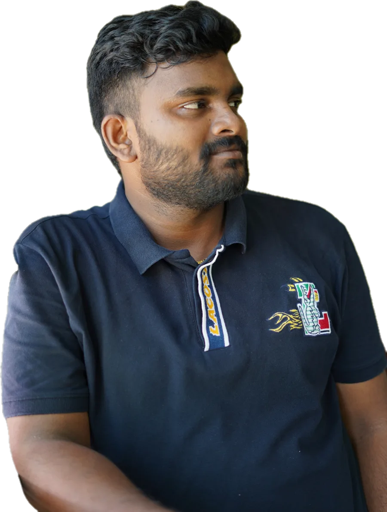
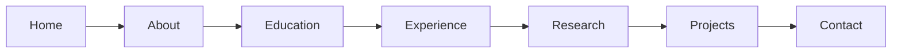

<div align="center">



# Sunil Kumar M

**Assistant Professor (Junior) · Ph.D. Researcher**<br>
Machine Learning & Autonomous Systems · Vellore Institute of Technology, Vellore

*Building explainable AI for intelligent autonomous systems.*

<a href="https://blessingstonsk.github.io/portfolio/"></a>

<a href="https://pages.github.com/"></a>


</div>

---

## About this repository

This is the source of my academic portfolio. It is a single static page that introduces my research on **explainable vision–language models for autonomous driving**, along with my education, experience, skills and applied projects.

The site is written in plain HTML, CSS and JavaScript with no framework and no build step, so it can be opened directly in a browser or hosted on any static host.

## Research focus

> My research explores how vision–language models can understand challenging driving scenes and provide explanations grounded in both visual evidence and language. I am particularly interested in contextual reasoning, faithful explanations, and evaluating model behaviour in complex and edge-case scenarios.

| Theme | What it covers |
| --- | --- |
| **Driving Scene Understanding** | Contextual reasoning in complex and unusual driving situations |
| **Multimodal Explainability** | Connecting model predictions to relevant image regions and language concepts |
| **Evaluation and Reliability** | Explanation faithfulness, human interpretability, uncertainty and robustness |

## What's on the site



| Section | Highlights |
| --- | --- |
| **Home** | Name, role and headline, with a cut-out portrait that turns in 3D as the cursor approaches |
| **About** | Short biography, key facts, Download CV, and skill tags that lift and glow on hover |
| **Education** | Ph.D. (VIT, ongoing), M.Sc. Computer Science (University of Madras), B.Sc. Computer Science (Loyola College) |
| **Experience** | Faculty role at VIT, plus internships at NEVAR Systems, OpenWeaver and CSIR–CLRI |
| **Research** | An interactive 3D street scene linked to the three research themes above |
| **Projects** | GIS-Integrated Drone Inspection, ASL Recognition and a Dynamic Ticketing Portal, each with a details panel |
| **Contact** | Address, email, LinkedIn, GitHub and Google Scholar |

## Interactive features

<table>
<tr>
<td width="50%" valign="top">

**3D research scene**<br>
A WebGL street with a LiDAR-style point cloud, 3D bounding boxes and labels. Choosing a research theme changes the scene: objects are boxed, evidence regions glow, or fog rolls in to show uncertainty. Drag to look around, scroll or pinch to zoom. It is labelled as an illustration, not a working model.

</td>
<td width="50%" valign="top">

**3D portraits**<br>
The hero and About photos turn toward the cursor, with the background layers moving at different depths and a soft light following the pointer.

</td>
</tr>
<tr>
<td valign="top">

**Depth-tilt project cards**<br>
Project cards lean toward the cursor, with the illustration and title moving at different depths.

</td>
<td valign="top">

**Glowing text and skills**<br>
Description text lights up word by word under the cursor, and skill tags lift and glow when hovered.

</td>
</tr>
</table>

Other details:

- Dark charcoal theme with warm yellow accents, plus a light-mode toggle
- Sticky navigation that highlights the current section, with a menu for phones
- Accessible by keyboard; motion effects switch off for visitors who prefer reduced motion
- The 3D scene pauses when scrolled out of view, and falls back to a plain message without WebGL

## Built with

| Layer | Used |
| --- | --- |
| Markup and styling | Semantic HTML5, hand-written CSS with custom properties |
| Interaction | Vanilla JavaScript |
| 3D | [Three.js r128](https://threejs.org/) from cdnjs |
| Type | Poppins, IBM Plex Sans and JetBrains Mono from Google Fonts |
| Hosting | GitHub Pages |

## Repository structure

```text
.
├── index.html                 # The whole site: markup, styles and scripts
├── images/
│   ├── portrait-cutout.webp   # Hero portrait (transparent background)
│   ├── research-portrait.webp # About portrait (transparent background)
│   └── favicon.jpg
├── File/
│   └── Sunil Kumar M.pdf      # CV for the Download CV button
├── .nojekyll                  # Serve files as-is on GitHub Pages
└── README.md
```

## Run it locally

No install is needed. Either open `index.html` in a browser, or serve the folder so every feature behaves as it does online:

```bash
python -m http.server 8000
```

Then visit `http://localhost:8000`.

## Updating the content

Most details live in one block near the top of the script in `index.html`:

| What to change | Where |
| --- | --- |
| Name, photos, CV, email, phone and profile links | `PROFILE` |
| Publications (the section appears once one is added) | `PUBLICATIONS` |
| Project details, technologies and repository links | `PROJECTS` |
| Research theme text | `RESEARCH` |

<details>
<summary><b>Example: adding a publication</b></summary>

```js
const PUBLICATIONS = [
  {
    title: "Paper title",
    authors: "Sunil Kumar M, Co-author",
    venue: "Conference or journal",
    year: 2026,
    doi: "10.xxxx/xxxxx",
    paper: "https://…",
    code: "https://…",
  },
];
```

</details>

After editing, commit and push to `main`. GitHub Pages republishes the site within a minute or two.

## Connect

<p>
<a href="https://blessingstonsk.github.io/portfolio/"></a>
<a href="https://www.linkedin.com/in/m-sunil-kumar2001/"></a>
<a href="https://scholar.google.com/citations?user=v22ltx8AAAAJ&hl=en"></a>
<a href="mailto:blessingstonsunilkumar@gmail.com"></a>
</p>

I welcome conversations with researchers, faculty and industry teams working on vision–language models, explainable AI and autonomous systems.

## Credits

- Layout and colour ideas were inspired by the [Clark](https://colorlib.com) template by Colorlib.
- 3D rendering by [Three.js](https://threejs.org/).

---

<div align="center">
<sub>© 2026 Sunil Kumar M · All rights reserved for the written content, photographs and CV.</sub>
</div>
